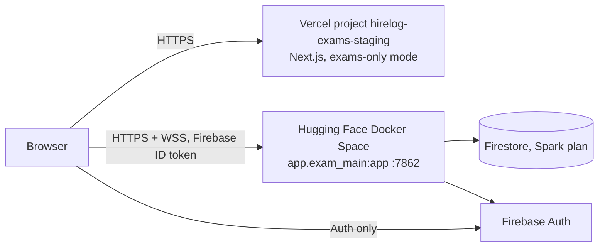

# HireLog Exams - staging deployment (free tiers)

> **Superseded in part (2026-10-11).** The exams branch (`exams/phase-11-production-qualification`) now serves the exam API
> from the main backend (see `docs/exams/deployment-guide.md` there), so staging uses the **existing** backend Space and no
> new Hugging Face Space is created (Hugging Face now requires a paid plan for new Docker Spaces). The Vercel project
> `hirelog-exams-staging` is kept as the public front for that branch: it is deployed from the exams branch with
> `NEXT_PUBLIC_EXAMS_API_BASE_URL` pointing at the existing Space. The sections below about a separate Space, `app.exam_main`
> as its own service, the `stg_` prefix and the staging web mode describe the earlier design on this branch, which the
> exams branch does not contain. Keeping the exam workers inside the free Firestore plan is handled in
> `hardening/exams-spark-safe-workers`.

This is the runbook for the **independent staging** of HireLog Exams: its own web app (Vercel), its own
API (Hugging Face Docker Space) and the Firebase **Spark** (free) plan. It is written for a cohort of at
most 80-90 students. The general exam API guide is [exams/deployment-guide.md](exams/deployment-guide.md);
the rollback levers are in [exams/rollback-runbook.md](exams/rollback-runbook.md).

Everything below was verified locally unless it is marked **not yet verified**.

## 0. Status (2026-10-11)

| Piece | State | Evidence |
|---|---|---|
| Web app | **Deployed** at https://hirelog-exams-staging.vercel.app (project `hirelog-exams-staging`, a production-target deployment of branch `hardening/exams-staging`) | anonymous probes: `/` answers 307 to `/exams/login`, `/exams/login` answers 200, every response carries `X-Robots-Tag: noindex, nofollow`, the CSP `connect-src` lists only the exam API host and Google/Firebase hosts, and the served bundle holds the staging API host and the Firebase web config but no emulator URL |
| Firebase (shared project) | The two approved writes are made (section 3) | the authorized-domain list was re-read after the change: 6 entries, none removed |
| Real Firestore | Verified with the dedicated service account | an HTTP-level exam scenario ran against real Firestore inside the throwaway prefix `stg_smoke_`: institution, roster, exam release and admission, autosave, a stale draft refused, the faculty grid's ordered query, submit and its idempotent retry, a student denied the faculty grid, a revoked member refused on the next call. 9/9 checks, then every document under that prefix was removed. Firebase **Auth** was not part of that run (token verification was replaced by the test issuer) |
| Exam API | **Not deployed.** Hugging Face answered `402 Payment Required` when the Space was created (section 5, step 2) | nothing was created or uploaded on Hugging Face |
| Sign-in on the deployed stack | **Not testable until the API exists.** Anyone but the operator also needs an SMTP provider (none configured) | |

Pending decision: where the exam API is hosted (section 5, step 2). Until then the web app is up but cannot sign anyone in.



## 1. What is separate from production, and what is not

| | Production HireLog | Exams staging |
|---|---|---|
| Git branch | `main` (never touched) | `hardening/exams-staging`, to be merged into `exams/phase-11-production-qualification` by pull request |
| Web app | existing Vercel project | **new** Vercel project `hirelog-exams-staging` |
| API | existing Hugging Face Space | **new** Space `hirelog-exams-staging` (`backend/Dockerfile.exams`) |
| Firebase project | `placement-archive` | the same project, every collection prefixed `stg_` (decision in section 3) |

Protections that are in the code, not only in configuration:

- `EXAM_STORAGE_BOUNDARY=true` (set by `Dockerfile.exams`): the process can only open the exam and
  institution collections; any other collection (including the legacy `users`, `interview_experiences`) raises
  before a request is made. `EXAM_COLLECTION_PREFIX` optionally prefixes every collection name.
- `NEXT_PUBLIC_EXAMS_STAGING=true`: the web build never contacts the legacy API (its CSP does not even list it),
  shows no legacy navigation, sends `X-Robots-Tag: noindex` and sends `/` to `/exams/login`.
- The API refuses every origin except `ALLOWED_ORIGINS`, and no protected route works without a Firebase ID
  token. `backend/scripts/smoke_exams_api.py` checks this against a running instance.
- Identity comes from the verified token only. Institutional access is re-checked on **every** request, so a
  revoked student loses access immediately (browser-verified: section 8).

## 2. Spark plan budget (the binding constraint)

Spark gives, per project and per day: 50,000 document reads, 20,000 writes, 20,000 deletes (and 1 GiB stored).
When the quota is exhausted every read/write of that project fails until the daily reset.

Measured with `backend/tests/test_exam_firestore_budget.py` (an in-process simulation that counts every
document operation; run it with `EXAM_BUDGET_FULL=1` for the full cohort):

| Scenario | Reads | Writes |
|---|---|---|
| 90 students x 10 questions, whole exam (admit, answer, proctoring, faculty monitor, submit, grading) | 11,948 (24% of the day) | 5,584 (28% of the day) |
| API idle for a day (adaptive background loops) | about 1,700 | about 0 |

Consequences:

- One 90-student exam fits. **Two cohorts in one day, or a second heavy use of the same project, may not.**
- The browser's autosave waits for a 3 s pause and never re-saves identical content, the live screens refetch at
  most every 20 s (students 3 s), and the candidate grid is cached - each of these exists only to stay inside the quota.
- A project shared with production HireLog shares this quota with it. See section 3.
- Spark has no Cloud Storage bucket: proctoring evidence is kept in memory and is lost when the API restarts.

## 3. Firebase: decision and changes made

The master prompt allows reusing the existing project only after an impact assessment and explicit approval.
The assessment (read-only) found: project `placement-archive` is on Spark; it has only the `(default)` Firestore
database; production HireLog already uses the same daily quota; a named database is impossible without billing;
the deployed security rules differ from the repository's.

| Option | Production risk | Cost | Needs |
|---|---|---|---|
| A. Reuse `placement-archive` (default DB) with the code-level boundary | A busy exam day can use about a quarter of production's daily quota; a compromised API credential would carry production's project | none | explicit approval, a service account, an authorized domain for the staging web origin |
| B. A **new** free Spark Firebase project (recommended) | none | none | creating the project, enabling Auth (Google) and Firestore, a service account, the web app config |

Whichever is chosen, nothing is written to Firebase until you approve it. Rules and indexes are never deployed
by these scripts; `firestore.rules` already denies every exam and institution collection to browser clients
(`backend/scripts/check_exam_rules_emulator.py` proves it against the emulator: 11/11 checks). A static audit of
every exam query found only single-field and equality-only filters, so **no composite index is needed**; the
scenario run against real Firestore (section 0) executed the ordered faculty-grid query without an index error.

**Decision recorded: option A** (reuse `placement-archive`'s default database), run with
`EXAM_COLLECTION_PREFIX=stg_` so every staging collection is namespaced and removable. Verified on the
emulator: the 11 browser journeys with the prefix created 18 top-level collections, all `stg_`-prefixed, and
nothing else. Option A needed two writes to the shared project. The owner approved both and they were made on
2026-10-11:

1. A dedicated service account for the API with only `roles/datastore.user` (the API uses only `verify_id_token`
   and `create_custom_token`, which sign locally with the key, so no Auth role is needed). Do not reuse the broad
   `firebase-adminsdk` key. IAM cannot restrict that role to certain collections, so the code-level boundary is
   the only collection-level isolation: treat the key as a secret with production-wide reach.
2. The Vercel staging origin added to Firebase Auth "authorized domains" (required for the operator's Google
   sign-in popup; students sign in with a one-time code and custom token).

Before the change the project had one service account (`firebase-adminsdk-fbsvc`, broad) and the authorized
domains `localhost`, `placement-archive.firebaseapp.com`, `placement-archive.web.app`, `hirelogapp.vercel.app`,
`hirelog-exams.vercel.app`. After it, the same five plus `hirelog-exams-staging.vercel.app` (re-read: nothing was
removed), and the service account above with a key file kept outside the repository (it goes straight into the API
host's secret store and is never printed). The commands:

```powershell
gcloud iam service-accounts create exams-staging-api --project placement-archive --display-name "HireLog Exams staging API"
gcloud projects add-iam-policy-binding placement-archive --member "serviceAccount:exams-staging-api@placement-archive.iam.gserviceaccount.com" --role roles/datastore.user --condition=None
gcloud iam service-accounts keys create "$HOME\exams-staging-api-key.json" --iam-account exams-staging-api@placement-archive.iam.gserviceaccount.com

# PATCH replaces the whole list, so it repeats the existing domains and adds one
$token = gcloud auth print-access-token
$body = '{"authorizedDomains":["localhost","placement-archive.firebaseapp.com","placement-archive.web.app","hirelogapp.vercel.app","hirelog-exams.vercel.app","hirelog-exams-staging.vercel.app"]}'
Invoke-RestMethod -Method Patch -Uri "https://identitytoolkit.googleapis.com/admin/v2/projects/placement-archive/config?updateMask=authorizedDomains" -Headers @{ Authorization = "Bearer $token"; "x-goog-user-project" = "placement-archive" } -ContentType "application/json" -Body $body
```

Undo (also the way to retire the staging): `gcloud iam service-accounts delete exams-staging-api@placement-archive.iam.gserviceaccount.com --project placement-archive`
(this invalidates its key), PATCH the domain list back without `hirelog-exams-staging.vercel.app`, delete the local key
file, and delete the `stg_*` collections in the console.

Side effect that comes with option A: every student who signs in with a one-time code becomes a Firebase **Auth user**
(uid `exam-<hex>`) in the shared project, listed in the console next to real HireLog users. They are inert, but they are
only removable by deleting those users.

## 4. Configuration reference

**Hugging Face Space** (set by `backend/scripts/deploy_hf_exams_space.py`; secrets are Space secrets, the rest variables;
any other host needs the same names as environment variables):

| Name | Kind | Value |
|---|---|---|
| `EXAMS_ENABLED` | variable | `true` |
| `ENV` | variable | `staging` |
| `FIREBASE_PROJECT_ID` | variable | the Firebase project id |
| `ALLOWED_ORIGINS` | variable | the exact web origin, e.g. `https://hirelog-exams-staging.vercel.app` (never `*`) |
| `EXAM_STORAGE_BOUNDARY` | variable | `true` |
| `EXAM_COLLECTION_PREFIX` | variable, optional | e.g. `stg_` |
| `FIREBASE_SERVICE_ACCOUNT_JSON` | secret | the service account key (never committed or printed) |
| `EXAM_OTP_HMAC_SECRET` | secret | a long random string; keeps one-time codes valid across restarts |
| `EXAM_FACULTY_EMAILS` | secret | platform operators' Google emails, comma-separated, as many as needed (a verified email is required; every operator can administer every institution and grant any role, so list only people you trust). The deploy script accepts spaces or commas and rejects anything that is not an address |
| `EXAM_OTP_SMTP_HOST`, `_PORT`, `EXAM_OTP_FROM_ADDRESS`, `EXAM_OTP_SMTP_USE_SSL` | variables | the mail provider; **without them sign-in codes cannot be delivered and login answers 503** |
| `EXAM_OTP_SMTP_USERNAME`, `EXAM_OTP_SMTP_PASSWORD` | secrets | SMTP credentials |

Never set `EXAM_OTP_ALLOW_DEV_SINK` outside local development (it prints codes to the log).

**Vercel project** `hirelog-exams-staging` (created 2026-10-11 in the existing Vercel team; Root Directory `frontend`, Node 22.x,
connected to this GitHub repository, framework preset Next.js). Its Ignored Build Step builds only the branch
`hardening/exams-staging` and branches under `exams/`, so a push to `main` or any other branch never builds in this project:

| Name | Value |
|---|---|
| `NEXT_PUBLIC_EXAMS_ENABLED` | `true` |
| `NEXT_PUBLIC_EXAMS_STAGING` | `true` |
| `NEXT_PUBLIC_EXAMS_API_BASE_URL` | the API base URL (no trailing slash, no `/api/exams/v1`). **Currently the placeholder `https://rockstar00-hirelog-exams-staging.hf.space`, which does not exist** (section 5, step 2). Changing it needs a redeploy: the build inlines it and derives the CSP `connect-src` from it |
| `NEXT_PUBLIC_FIREBASE_API_KEY`, `_AUTH_DOMAIN`, `_PROJECT_ID`, `_STORAGE_BUCKET`, `_MESSAGING_SENDER_ID`, `_APP_ID` | the Firebase web app config of the chosen project (public values; the API key has no referrer restriction and allows the Identity Toolkit and Secure Token APIs) |

The variables apply to the Production and Preview environments. Do **not** set `NEXT_PUBLIC_API_BASE_URL`,
`NEXT_PUBLIC_FIREBASE_AUTH_EMULATOR_URL` or `NEXT_PUBLIC_E2E_BYPASS_AUTH`.
The Firebase Auth "authorized domains" list must contain the web origin (needed for Google sign-in); only
`hirelog-exams-staging.vercel.app` was added, so Google sign-in will not work on per-deployment Preview URLs.

**Production Branch.** The Vercel REST API did not accept a production branch when tried (project update and Git
re-link, 2026-10-11), so it is still `main`, which is harmless because the Ignored Build Step skips `main`. Consequently
the production domain is not updated by a push; it is updated by creating a production-target deployment of the branch
(section 5, step 4). To make pushes deploy automatically, set the branch in the Vercel dashboard (project Settings,
Environments, Production, Branch Tracking) to `exams/phase-11-production-qualification` after the pull request is
merged. Do not point it at `main`.

## 5. First deployment

Prerequisites you provide: the Firebase decision (section 3, made), a Hugging Face token with write access **on an
account that may create Docker Spaces (step 2)**, Vercel access, and an SMTP account. Secrets go into the environment
of your own terminal or the provider dashboards, never into the repository or a chat.

1. **Review the branch.** The work is on `hardening/exams-staging` (pushed; `main` and the exams branch are untouched).
   Open a pull request **with base `exams/phase-11-production-qualification`** (GitHub defaults to `main`; do not
   merge into `main`). `.github/workflows/exams-ci.yml` also runs on the push itself and is green.
   *Pushing a branch creates a Preview deployment in the existing production Vercel project (and, for this branch, in
   the staging project). Previews do not touch production traffic or data, but they are builds of this code in those
   projects; an Ignored Build Step in the production project would skip them.*
2. **API - blocked on 2026-10-11, decision pending.** `backend/scripts/deploy_exams_staging.ps1` ran for
   `rockstar00/hirelog-exams-staging` and stopped at its first write: Hugging Face answered `402 Payment Required`
   ("hosting Gradio and Docker Spaces on free cpu-basic requires a PRO subscription"). Hugging Face's documentation says
   creating a Gradio or Docker Space needs a paid plan (PRO, $9/month, for a personal account; Team or Enterprise for an
   organisation) and that Static Spaces stay free. The account is on the free plan; the existing production Space was
   created earlier (04/04/2026) and keeps running. Nothing was created or uploaded and the token was not stored.
   Ways forward:
   - **Upgrade the account to PRO**, then run the wrapper again unchanged (below). Same platform and size as production.
   - **Host `backend/Dockerfile.exams` elsewhere.** The image is host-agnostic (port 7862, the environment names in
     section 4, WebSocket support, exactly one instance, outbound SMTP) but the deploy script is Hugging Face only, so
     another host needs its own script or dashboard steps. Render's free web service is a poor fit (0.1 CPU / 512 MB, it
     spins down after 15 minutes without traffic and takes about a minute to wake, and it blocks outbound ports 25, 465
     and 587); Google Cloud Run needs a Google Cloud project with billing enabled. Neither was tried.
   - Whatever host is chosen, set `NEXT_PUBLIC_EXAMS_API_BASE_URL` (section 4) to its base URL and create a new
     production-target deployment of the web app (step 4).

   Running the wrapper (PowerShell). It asks for the Hugging Face token and the SMTP password at hidden prompts,
   generates the one-time-code signing secret, and calls `deploy_hf_exams_space.py`:
   `.\backend\scripts\deploy_exams_staging.ps1 -Owner <hf-user> -FirebaseProjectId <id> -ServiceAccountPath <key.json> -AllowedOrigin <web origin> -FacultyEmails <operator email>,<operator email> -SmtpHost <host> -SmtpFrom <address> -DryRun`
   (the dry run needs no network or token and was run: it builds the 147-file bundle and prints the plan; drop `-DryRun`
   to deploy; the Space is created public because a browser cannot call a private Space, and the API still requires a
   Firebase sign-in for every protected route; a public Space also publishes the source of `backend/app`, and its
   variables, but not its secrets). The script only targets a Space whose name contains `staging`, never overwrites a
   Space it did not create, and waits for `/health/live`. Needs `pip install huggingface_hub` (use a throwaway
   virtual environment). **Everything after the Space creation call is not yet verified against Hugging Face.**
3. **Smoke test the API:** `python backend/scripts/smoke_exams_api.py --base-url https://<owner>-hirelog-exams-staging.hf.space --allowed-origin <web origin> --expect-ready`.
4. **Web - done on 2026-10-11.** The project was created through the Vercel REST API with the settings in section 4, and
   the first deployment was a production-target deployment of the branch, which is also how the production domain is
   updated later (a push alone only creates a Preview; `$env:VERCEL_TOKEN` is an access token from your Vercel account
   settings, kept in your shell only):
   ```powershell
   $h = @{ Authorization = "Bearer $env:VERCEL_TOKEN" }
   $body = @{ name = 'hirelog-exams-staging'; project = 'hirelog-exams-staging'; target = 'production'
              gitSource = @{ type = 'github'; repoId = 1156701802; ref = 'hardening/exams-staging' } } | ConvertTo-Json -Depth 4
   Invoke-RestMethod -Method Post -Uri 'https://api.vercel.com/v13/deployments?slug=sai-abhinavs-projects' -Headers $h -ContentType 'application/json' -Body $body
   ```
   The build took about a minute and the deployment reached `READY` on https://hirelog-exams-staging.vercel.app (probes in
   section 0). The domain was added to the Firebase Auth authorized domains (section 3). **Not verified:** a sign-in
   and any call to the API, which does not exist yet.
5. **Seed.** Sign in at `/exams/login` with a Google account listed in `EXAM_FACULTY_EMAILS` (a platform operator),
   open "Institution & roster", create the institution, paste the roster (`college ID, email[, role]` per line; the role
   defaults to `student`), check it and apply it. Share the student sign-in link shown on that screen
   (`/exams/login?institution=<id>`). Who signs in how: the **operator** uses Google; **everyone in a roster**, students and
   faculty alike, signs in with their college ID and a one-time code emailed to the roster address (SMTP required). There
   are no passwords and no password-reset emails. An operator can add a faculty member with the role `faculty` (a faculty
   member can only add students); that path is covered by API tests but has not been run in a browser journey.
6. **Browser E2E against the deployed stack** (section 8) - **not yet run**; the local journeys use the emulators.

## 6. CI/CD

| Workflow | Trigger | What it does |
|---|---|---|
| `ci.yml` (existing) | every pull request, pushes to `main` | legacy backend and web checks. Its `npm audit --audit-level=high` also counts dev-only tooling that has no upstream fix (the `braces` chain under `eslint-config-next`), so it can be red on this branch for that reason alone |
| `exams-ci.yml` | pull requests touching `backend/` or `frontend/`, pushes to `exams/**` and `hardening/**`, manual | exam API lint + tests on **only** the slim hash-pinned dependency set, `pip-audit` (strict), `bandit`, `npm audit --omit=dev` (strict), web lint/type-check/unit tests/staging build, and an image build that must boot and must not contain the ML stack |

Neither workflow deploys. To inspect a run, open the Actions tab; to re-run, use "Re-run jobs" or `workflow_dispatch`.
Deploys are manual: the script in step 2 for the API; for the web app, Vercel's Git integration builds Previews of the
allowed branches and the production domain is updated by the production-target call in step 4 (or automatically once the
production branch is switched, section 4).
Regenerate the API lock after changing `backend/requirements-exams.txt`:
`uv pip compile backend/requirements-exams.txt --universal --python-version 3.11 --generate-hashes -o backend/requirements-exams.lock`.

## 7. Rollback

| Layer | How |
|---|---|
| Stop new exam starts immediately | set `EXAM_NEW_ADMISSIONS_PAUSED=true` on the Space (in-progress attempts continue), or pause one session from the control screen |
| Whole exam API | set `EXAMS_ENABLED=false` on the Space, or revert the Space repository to its previous commit (every deploy is one commit whose message carries the source SHA) |
| API code | check out the previous good tag/commit and run the deploy script again |
| Web app | Vercel dashboard, Deployments, "Promote to production" on the previous deployment |
| Firebase data | nothing here migrates or deletes data; the exam collections can be cleared by deleting the `EXAM_COLLECTION_PREFIX` collections (if used) in the console. Never delete anything in a shared project without checking the prefix |
| Production HireLog | not involved at any step; `main` is unchanged |

## 8. Tests

| Layer | Command | Result at the time of writing |
|---|---|---|
| Exam API | `cd backend && PYTHONPATH=. pytest --ignore=tests/test_concurrency.py --ignore=tests/test_experience_lifecycle.py` | 575 passed, 1 skipped on the slim lock environment (re-run on 2026-10-11 on Windows, and earlier in a Linux container); the Exams CI run on the pushed branch is green (backend, security, web, image jobs) |
| Web | `cd frontend && npm run lint && npm run type-check && npm run test:ci && npm run build` | lint 1 pre-existing warning, 57 unit tests passed, build ok |
| Firestore rules | `python backend/scripts/check_exam_rules_emulator.py` (emulator running) | 11/11 |
| Image | `docker build -f backend/Dockerfile.exams backend` | builds from the hash-pinned lock, boots as a non-root user, `/health/live` 200 |
| Real-browser journeys | `e2e-local\start-stack.ps1` then `e2e-local\run-e2e.ps1` (Windows PowerShell; needs Java, Node, Playwright's Chromium) | 11/11 passed on the local emulator-backed stack |
| Cohort rehearsal | `python e2e-local/cohort_rehearsal.py` | 90 students x 10 questions, 2,700 autosaves: all 90 finalised, 0 errors, p95 at most 163 ms (max 226 ms) - **emulator on one laptop, not evidence of real Firestore or Hugging Face capacity** |

The 11 journeys: staging landing (no legacy navigation, noindex), anonymous redirects, operator Google sign-in,
institution and roster, authoring through scheduling, lobby release, a student's one-time-code sign-in to a
confirmed receipt, the live grid, a wrong and a replayed code, faculty screens denied to a student, a student
revoked mid-exam being cut off and unable to sign in again, and a student of another institution seeing nothing
of the first institution's exam.

## 9. Known limits (do not claim more than this)

- **Question content is generated by a deterministic development generator** (questions are prefixed `[fake]`); no
  real generation, independent-review, feedback or similarity provider is configured, and the coding judge is
  the deterministic fake (the Judge0 adapter's `submit` is not implemented). Coding questions are therefore not graded for real.
- A variant pool must hold at least as many approved questions as students, unless "share question variants" is
  ticked in the lobby. The UI generates four candidates per click.
- The malware scanner is the safe default (never "clean"), so uploaded files stay quarantined and only URL sources can be approved.
- Proctoring evidence lives in memory (no Storage bucket on Spark). Camera capture and fullscreen are best-effort
  browser signals, not lockdown.
- One API instance only: the live socket, rate limiters and caches are per process. A Space restart drops live sockets
  (clients reconnect) and in-memory evidence.
- One-time codes need an SMTP provider. None is configured, so real delivery has **not** been verified; the local journeys read the code from the log.
- Free Spaces sleep when idle; open the Space and check `/health/ready` before an exam.
- The 11 journeys and the rehearsal ran on emulators. Real Firestore latency, quotas, IAM and Vercel/Hugging Face behaviour are unverified.

## 10. Exam-day checklist

1. `GET /health/ready` is 200 and `storage_boundary.enforced` is true; run the smoke script.
2. The roster is applied and a test student has signed in from a different device.
3. Questions are approved (at least as many variants as students, or balanced reuse ticked) and the session is scheduled
   with the right duration; assign questions, publish, then release from the lobby.
4. Keep one faculty tab on the control screen; use Refresh if the grid looks stale.
5. After the exam, close the session; the day's Firestore usage should stay well under the Spark quota.
